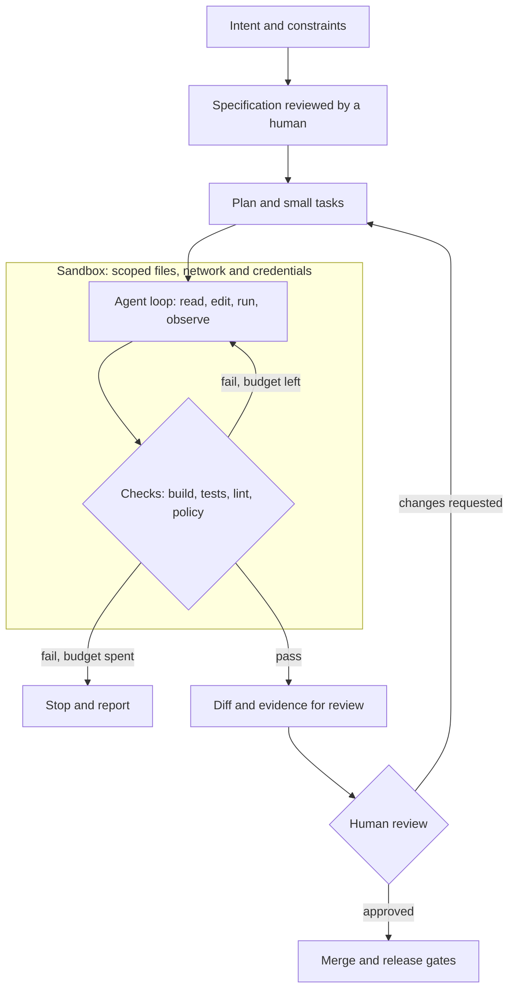

# Coding Agents and Spec-Driven Development

## Purpose and scope

A coding agent reads a repository, edits files, runs commands and tests, and iterates until a goal is met or a budget runs out. Products include Claude Code, OpenHands, Codex and SWE-agent. This note explains how to design and govern that loop. It covers the interface the agent works through, the specification it works from, the reusable skills it loads, and the checks that decide whether its work is accepted.

The note treats a coding agent as a production system with authority over code, not as autocomplete. It delegates general agent evaluation to [Production AI Assurance](../ai-architecture/production-ai-assurance.md), learning from traces to [Self-Improving Agent Systems](self-improving-agent-systems.md), and restart and duplicate-safety rules to [Durable Workflows and Idempotency](../cross-cutting-patterns/durable-workflows-and-idempotency.md). Product names are dated examples of durable ideas, not recommendations.

## Pareto summary

- **The interface shapes the agent.** SWE-agent showed that tools designed for a model, such as bounded file viewers, search and linted edits, outperform giving it a raw shell. Design the agent–computer interface as deliberately as an API.
- **A specification is the unit of delegation.** Spec-driven development turns intent into a reviewed spec, a plan and small tasks before code is written. The spec is what humans review and what the agent is held to.
- **Tests are the oracle; review is still required.** Executable checks decide most acceptance. Humans review the spec, the risky diffs and anything the tests cannot see, such as security, data handling and design fit.
- **Context is a budget.** Load knowledge on demand through skills and retrieval, compact long sessions, and keep durable notes outside the context window.
- **Prefer one agent until parallelism is real.** Multi-agent designs pay for coordination in tokens and errors. Use them for genuinely independent subtasks, not because a task is large.

## First-principles model

An agent writes code well when three things hold: it knows what "done" means, it can observe the effect of its changes, and it cannot cause damage beyond an agreed boundary. Spec-driven development supplies the first. The interface and test harness supply the second. Sandboxing, permissions and review supply the third.

The loop is only as good as its observations. Fast, deterministic tests let the agent correct itself; flaky or missing tests make it guess. "Loop engineering" means designing this cycle: what the agent may run, what it sees after each action, when it stops, and what evidence it hands back.

## Core decisions and trade-offs

**Agent–computer interface.** Give the agent tools with small, predictable outputs: search that returns locations, file views with line ranges, edits that are linted before they are accepted, and command output that is truncated with a clear marker. Large raw outputs waste context and hide the signal. Treat tool descriptions as part of the interface contract and version them.

**Specification depth.** A spec states the goal, users, acceptance criteria, constraints, non-goals and the parts of the system that must not change. GitHub's open-source Spec Kit is one public workflow: a project "constitution" set once, then specify, plan, tasks, implement and converge for each feature. A heavy spec for a one-line fix is waste; no spec for a cross-cutting change invites the agent to invent requirements. Scale the spec to the blast radius.

**Skills and context.** Agent Skills, an open format that Anthropic originated, package a procedure as a folder with a `SKILL.md` file plus optional scripts and references. Agents load only each skill's name and description at start-up and read the full instructions when a task matches. This progressive disclosure keeps many procedures available without filling the context. Use skills for repeatable house procedures, such as release steps or review checklists. Use retrieval for facts, and repository instruction files for conventions every task needs. Anthropic's context-engineering guidance adds compaction, structured notes outside the window, and just-in-time loading for long sessions.

**Authority and sandboxing.** Run the agent with the least privilege the task needs: scoped working tree, no production credentials, network allowlists, and approval for destructive commands. Prompt injection can arrive through issue text, dependencies, web pages or tool output, so treat everything the agent reads as data. A merge, deployment or secret access remains a human or pipeline decision outside the agent. Tool access also creates privacy risk: in PrivacyLens tests, models acting as agents leaked sensitive information in roughly a quarter to two-fifths of cases even when told to protect privacy. Scope what the agent can read, not just what it can write.

**Single agent versus multiple agents.** Anthropic reports that its multi-agent research system beat a single agent on breadth-first research, but used about 15 times the tokens of a chat interaction. It also notes that most coding tasks have fewer truly parallel parts than research. Cognition argues the opposite failure: parallel agents act on implicit, conflicting assumptions unless they share full context. Cemri et al. analysed over 1,600 multi-agent traces and grouped the failures into system design issues, inter-agent misalignment and weak task verification. Start with one agent and a clear spec. Split only when subtasks are independent, each can be verified separately, and the extra cost is justified.

**Measuring the agent.** SWE-bench, built from real GitHub issues and their tests, made "resolve the issue so the hidden tests pass" the standard measure. Treat public leaderboards as a starting signal only. Build an internal set from your own repositories, with your conventions, tests and review standards. Track resolved tasks, review-required rework, reverted changes, cost and time per accepted change, and escaped defects.

## Failure modes and warning signs

- **Test gaming:** the agent edits or deletes tests, adds special cases, or weakens assertions to turn checks green. Protect test files, review test diffs separately and run held-out checks.
- **Spec drift:** the implementation quietly widens or narrows the spec. Compare the final diff with the acceptance criteria, not just with "tests pass".
- **Plausible but wrong changes:** fluent code that compiles and passes thin tests but breaks an unstated invariant. Strengthen tests around invariants and require review for sensitive areas.
- **Context exhaustion:** long sessions lose earlier decisions, so the agent repeats work or contradicts itself. Compact deliberately and keep a written progress note.
- **Runaway loops:** retry-edit-retry cycles with no new information. Cap attempts, time and spend outside the model, and stop with a report.
- **Injected instructions:** text in an issue, README or dependency tells the agent to exfiltrate data or disable checks. Keep authority external and log every command.
- **Review overload:** agents produce more diffs than humans can review well, so review becomes a rubber stamp. Size tasks for review, and measure review quality, not just merge rate.

## Practical decision checklist

- What does "done" mean, and is it written as acceptance criteria the agent and reviewer share?
- Which tests, linters and policy checks decide acceptance, and are they fast and deterministic?
- What may the agent read, write, run and reach on the network? Which actions need approval?
- Which procedures should be skills, which facts should be retrieved, and what belongs in repository instructions?
- What are the attempt, time and cost budgets, and what happens when one is exhausted?
- Is a second agent justified by independent, separately verifiable subtasks?
- How are test changes, security-sensitive files and dependency updates reviewed?
- Which internal measures show whether the agent improves delivery: accepted changes, rework, reverts, escaped defects and cost?

## Worked architecture scenario

A team wants agents to handle routine dependency upgrades and small bug fixes across 40 services. The architect starts with one agent per task in a container with a scoped checkout, a package-registry allowlist and no deployment credentials.

Each task starts from a short spec generated from the ticket and approved by the service owner. It states the change, the services in scope, the acceptance tests and what must not change, such as public APIs and database schemas. A team skill encodes the upgrade procedure: read the changelog, update the lock file, run the test suite, and note breaking changes. The agent may retry failing tests three times within a 30-minute budget. After that it stops and reports what it tried.

Acceptance needs green tests, unchanged test files unless the spec allows otherwise, and a human review of the diff and the agent's summary. The team measures accepted changes per week, review time, reverts within 30 days and cost per accepted change, and compares them with the previous manual baseline. A second agent is considered only for large upgrades where services can be changed and verified independently.

## Feynman questions

1. Why can a better tool interface improve an agent more than a better model?
2. What does a spec give a reviewer that a passing test suite does not?
3. When is loading a skill better than retrieving a document, and when is it worse?
4. Why can adding a second agent make a coding task slower and less reliable?
5. Which measure would tell you an agent is creating hidden work for reviewers?

## Related canonical notes

- [Self-Improving Agent Systems](self-improving-agent-systems.md) owns improvement loops, trace-derived data and promotion of agent changes.
- [Production AI Assurance](../ai-architecture/production-ai-assurance.md) owns acceptance evidence, autonomy levels and rollout.
- [Reasoning System Design](../ai-architecture/reasoning-system-design.md) owns inference-time search and verification.
- [LLM Inference Systems](../ai-architecture/llm-inference-systems.md) owns serving, prefix caching and inference cost.
- [Durable Workflows and Idempotency](../cross-cutting-patterns/durable-workflows-and-idempotency.md) owns restart correctness and duplicate-safe effects.
- [Architecture Decision Method](../software-architecture/architecture-decision-method.md) owns decision records and reversal triggers.

## Sources and review status

Contributing courses (Fall 2026, accessed 2026-10-13): [Stanford CS329Z Engineering AI Agents](https://cs329z.stanford.edu/), [Stanford CS146S The Modern Software Developer](https://themodernsoftware.dev/) and [Harvard CS2680 Modern AI Systems](https://cs2680.seas.harvard.edu/).

Public primary references (verified 2026-10-13):

1. Yang et al., [SWE-agent: Agent-Computer Interfaces Enable Automated Software Engineering](https://arxiv.org/abs/2405.15793).
2. Wang et al., [OpenHands: An Open Platform for AI Software Developers as Generalist Agents](https://arxiv.org/abs/2407.16741).
3. Jimenez et al., [SWE-bench: Can Language Models Resolve Real-World GitHub Issues?](https://arxiv.org/abs/2310.06770).
4. GitHub, [Spec Kit](https://github.com/github/spec-kit) — an open-source spec-driven development workflow.
5. [Agent Skills overview](https://agentskills.io/) — open skill format and progressive disclosure.
6. Anthropic, [Effective context engineering for AI agents](https://www.anthropic.com/engineering/effective-context-engineering-for-ai-agents) (29 September 2025).
7. Anthropic, [How we built our multi-agent research system](https://www.anthropic.com/engineering/multi-agent-research-system) (13 June 2025).
8. Cognition, [Don't Build Multi-Agents](https://cognition.com/blog/dont-build-multi-agents) (12 June 2025).
9. Cemri et al., [Why Do Multi-Agent LLM Systems Fail?](https://arxiv.org/abs/2503.13657).
10. Shao et al., [PrivacyLens: Evaluating Privacy Norm Awareness of Language Models in Action](https://arxiv.org/abs/2409.00138).

**Status:** Current

**Edition:** Living

**Last reviewed:** 2026-10-13
